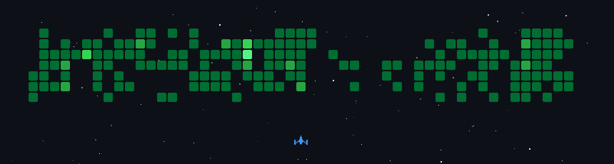

<div align="center">


# Hi, I'm Michael González 👋

### Full Stack Developer · AWS Cloud Developer

**🌐 [English](./README.md) · [Español](./README.es.md)**

I build maintainable web applications, microservices and cloud solutions, with a strong interest in serverless architecture, code quality and products that solve real problems.

[](https://github.com/qwery2052)
[](https://www.linkedin.com/in/myth-dev/)
[](https://www.npmjs.com/~mything)
[](https://marketplace.visualstudio.com/publishers/mythDev)


</div>

## About me

- 💻 Over **7 years of experience** in technology and software development.
- ☁️ I build and integrate solutions on **AWS**, focused on serverless architectures and microservices.
- 🧩 I work end to end across **backend, frontend, databases and cloud infrastructure**.
- 🧭 I have led teams, defined architectures, set coding standards and mentored other developers.
- 🌎 I have experience collaborating remotely with teams across **LATAM, India and Australia**.
- 🐈 Cat lover; I firmly believe every good deployment deserves feline supervision.

## What I'm working on

- Building microservices and workflows on AWS.
- Integrating relational and NoSQL data access layers.
- Technical optimization of infrastructure, performance and cloud costs.
- Consistent configuration and deployments with CloudFormation and Systems Manager.
- Daily technical communication in English within multicultural teams.

## Tech stack

### Cloud & backend

<p>
  
</p>

### Frontend

<p>
  
</p>

### Data, tools & DevOps

<p>
  
</p>

I also work with SQL Server, REST APIs, API Gateway, Lambda, S3, CloudWatch, SSM, CI/CD, PrimeNG, Ant Design, Scrum, SOLID principles and Clean Code.

## My professional approach

```text
Clear ideas → simple architecture → maintainable code → reliable deployments
```

I enjoy turning complex needs into understandable solutions. I aim for a balance between delivery speed, good architecture and maintainability, without over-engineering.

## Career highlights

- **Amaris Consulting** — Full Stack / Backend AWS Developer.
- **Universidad Surcolombiana** — Tech Lead and Project Coordinator.
- **Borg Financial (Australia)** — Freelance Full Stack Developer.
- **KWEKWE NEJ'WESX Project** — Frontend Developer with React and Next.js.
- Previous experience coordinating infrastructure, corporate support, servers and databases.

## Education

- 🎓 Systems Engineering.
- 🎓 Technology in Information Systems Analysis and Development.
- 🎓 Technician in Database Analysis and Design.
- 📚 Diploma in Data Analytics and Big Data.
- 📚 Diploma in PHP Programming.
- ☁️ AWS Cloud Practitioner training.

<!-- space-shooter:start -->

## My activity 🚀



[Generated with gh-space-shooter](https://github.com/czl9707/gh-space-shooter).

<!-- space-shooter:end -->

## GitHub

<div align="center">


<br/>


</div>

> Part of my professional experience lives in private repositories; here I'll keep sharing projects, tools and lessons that may be useful to other developers.

<div align="center">

### Thanks for stopping by


<sub>Building solutions, learning constantly and fixing bugs under feline supervision.</sub>

</div>
